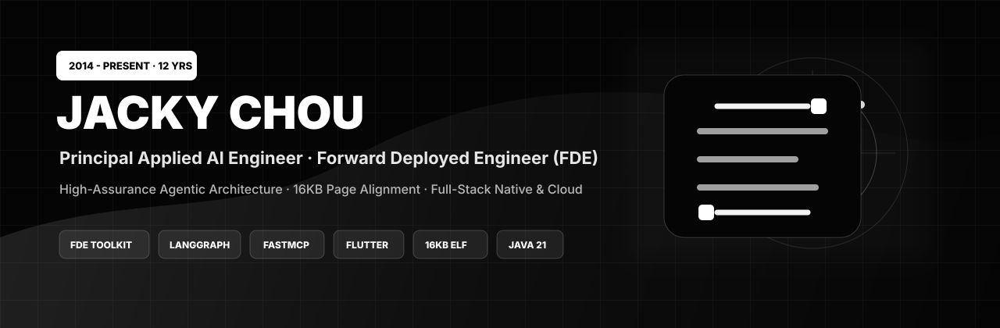

<p align="center">
  <a href="https://jacky-portfolio.pages.dev">
    
  </a>
</p>

# Jacky Chou

<p align="left">
  <strong>Principal Applied AI Engineer · Forward Deployed Engineer (FDE) · Full-Stack Native & Cloud Architect</strong><br>
  12 年软件系统工程经验（2014 年起至今，经历 Eclipse ADT ➔ Android Studio / Java ➔ Kotlin / Flutter 三端商业端 ➔ Spring Boot 权限中台 ➔ 生产级受控 Agent / FDE 现场交付）。
</p>

<p align="left">
  <em>I engineer mission-critical systems, high-assurance multi-agent architectures, mobile native runtimes, and zero-leak enterprise AI platforms with mathematically verifiable evidence.</em>
</p>

<p align="left">
  <a href="https://github.com/mikehot/fde-tools"></a>
  <a href="https://jacky-portfolio.pages.dev"></a>
  <a href="https://jacky-portfolio.pages.dev/resume/"></a>
  <a href="https://github.com/mikehot/rag-knowledge-base"></a>
  <a href="mailto:mikehot668@gmail.com"></a>
</p>

---

### ⚡ Core Production Stack (核心工业级技术栈)

<p align="left">
  
  
  
  
  
  
  
  
  
  
  
</p>

---

## 🛡️ Four-Dimensional Engineering Moat (四维技术壁垒)

```
                       ┌──────────────────────────────────────────────┐
                       │   High-Assurance Industrial AI & Systems     │
                       └──────────────────────┬───────────────────────┘
                                              │
         ┌────────────────────┬───────────────┴───────────────┬────────────────────┐
         ▼                    ▼                               ▼                    ▼
┌──────────────────┐ ┌──────────────────┐           ┌──────────────────┐ ┌──────────────────┐
│ Systems & Mobile │ │ Enterprise RAG   │           │ Controlled Agent │ │ Field Multimodal │
│ Native Runtimes  │ │ & RBAC Security  │           │ State Machine    │ │ Commercial Loop  │
├──────────────────┤ ├──────────────────┤           ├──────────────────┤ ├──────────────────┤
│ • 16KB Page Align│ │ • Java 21 / SB 3 │           │ • LangGraph DAG  │ │ • Dual-Vision QA │
│ • SafeMethodChan │ │ • Row-Level RBAC │           │ • FastMCP Tools  │ │ • Math Equation  │
│ • Dio 401 Mutex  │ │ • AST Citations  │           │ • 5-Step Breaker │ │ • pHash Idempot. │
└──────────────────┘ └──────────────────┘           └──────────────────┘ └──────────────────┘
```

### 1. 📱 端侧与系统级穿透力 (Systems & Mobile Native Penetration)
> **深度段表解析 · 状态机原子调度 · 并发请求单飞互斥**
* **Google Play 2026 16KB 内存页对齐**：深入 NDK 段表排查，开发纯 Python 64-bit ELF 自动解析器，精准定位非对齐 `.so` 依赖与汇编对齐修复。
* **Flutter-Native 安全通信基座**：设计 `SafeMethodChannel` 原子状态机调度，杜绝跨线程未初始化调用、死锁与内存悬垂指针。
* **网络与并发单飞互斥锁**：Dio 拦截器并发单飞（Single Flight）互斥锁，多请求并发 401 时仅单次换票、无缝重放，杜绝重复请求风暴。

### 2. 🔐 严密权限中台与防幻觉基座 (Strict RBAC & Anti-Hallucination Base)
> **物理行级隔离 · 0% ACL 越权泄露 · 后端真实引用硬校验**
* **Java 21 + Spring Boot 3 + pgvector**：物理隔离与动态 Tenant 过滤，保证多租户 RAG 检索 **0% ACL 越权泄露**。
* **独创后端 AST 引用真实性校验器**：强制模型回答携带物理页码与文本 Chunk Hash，若无真实依据强行断言 `found=false` 并触发人工降级。

### 3. 🤖 受控工业级 Agent 状态机 (Controlled Industrial Agent State Machine)
> **有向无环图 (DAG) · 5 步硬熔断 · 会话级动态撤权**
* **LangGraph + FastMCP 协议标准**：构建有向无环图（DAG），设定 5 步硬熔断（Bounded Loop）阻断模型死循环。
* **复杂意图拆解与动态撤权**：支持多目标递归分解（Decomposition 解决率 100%），高危只读/写入分离，不可逆操作会话级动态撤权与 Human-in-the-Loop 拦截。

### 4. 📄 现场服务多模态商业闭环 (Field Multimodal Commercial Loop)
> **双视觉模型互验 · 金额等式硬断言 · 图像哈希幂等防重**
* **现场单据自动化录入与智能核验**：双视觉模型互验交叉复核、金额等式硬断言（`Subtotal + Tax == Total`）。
* **感知哈希 (pHash) 幂等防重**：计算图片感知哈希与 MD5 组合键，弱网重试时 0 错误率、0 重复单，实现 3.3 个月商业 ROI 回收。

---

## ⭐ Featured Production Toolkits & Repositories (标杆武器库)

| Repository | Focus & Core Moat | Tech Stack | Production Status |
| :--- | :--- | :--- | :---: |
| [**`mikehot/fde-tools`**](https://github.com/mikehot/fde-tools) | **Field Deployed Engineer CLI Toolkit**: 16KB ELF alignment inspector, perceptual dHash idempotency generator, FastMCP server scaffolder, and Golden Dataset Evals runner. | Python 3.9+ · Zero Heavy Deps · CLI | [](https://github.com/mikehot/fde-tools/actions) |
| [**`mikehot/rag-knowledge-base`**](https://github.com/mikehot/rag-knowledge-base) | **Enterprise RAG Knowledge Base**: Multi-tenant SQL-level ACL isolation, backend-verified citations, `found=false` fail-closed handoff, 182 backend tests & repeated evaluation harness. | Java 21 · Spring Boot · Flutter · pgvector | [](https://github.com/mikehot/rag-knowledge-base/actions) |
| [**`mikehot/rag-agent-python`**](https://github.com/mikehot/rag-agent-python) | **Controlled RAG Agent Service**: LangGraph + bounded-loop orchestration, multi-step query decomposition (12/12), session memory with enforced revocation check (0/3 leakage). | Python 3.12 · FastAPI · LangGraph | [](https://github.com/mikehot/rag-agent-python/actions) |
| [**`mikehot/rag-mcp-server`**](https://github.com/mikehot/rag-mcp-server) | **Official MCP SDK Knowledge Server**: Stdio MCP server exposing ACL-scoped read-only knowledge tools with per-caller bearer passthrough and 22 contract tests. | Python 3.12 · MCP SDK v2 · httpx | [](https://github.com/mikehot/rag-mcp-server/actions) |
| [**Field Document Intake Agent (Case Study)**](https://jacky-portfolio.pages.dev/projects/doc-intake-agent/) | **Field Service Multimodal Write-Back Agent**: Dual-VLM cross-validation, deterministic table rules, idempotent work-order write-back (0 wrong auto-writes on held-out & real photos, 217 tests). | Python · Dual-VLM · Spring Boot | `Case Study` |

---

## ⚡ Fast Review Navigation (评审快速通道)

| Target Audience | Recommended Entry | What You Can Verify |
| :--- | :--- | :--- |
| **Hiring & Executive** | [Online Resume (在线中英双语简历)](https://jacky-portfolio.pages.dev/resume/) | 12 年系统演进、双品牌三端（Android/iOS/OHOS）上架实证与全栈交付边界 |
| **Enterprise Client** | [Commercial Portfolio (商业交付全景)](https://jacky-portfolio.pages.dev) | 三端商业 App、企业私有化 RAG/Agent 交付包、验收手册与阶梯合作方案 |
| **Engineering Leader** | [FDE CLI Toolkit 源码](https://github.com/mikehot/fde-tools) | 纯 Python ELF 页解析器、pHash 幂等锁、FastMCP 脚手架与 100% CI 绿标 |
| **Security & Architecture** | [Enterprise RAG + Agent + MCP 源码](https://github.com/mikehot/rag-knowledge-base) | SQL 内 ACL 权限过滤、引用校验器、撤权 0 泄露评测报告与 182 项后端测试 |
| **Confidential Verification** | [Email Request (保密审核请求)](mailto:mikehot668@gmail.com) | 私有商业代码库（双品牌三端 App / 单据幂等写回 Agent）提交记录与构建证据 |

---

## 📜 Core Delivery Principles (四大交付军规)

1. **Evidence First (证据第一)**：架构不是主观空谈；屏幕录屏、构建日志、Lint 检查、CI 绿标、ELF 段表和单测跑分是交付物的天然组成部分。
2. **AI with Ironclad Boundaries (防线严密)**：AI 模型绝不能绕过企业业务权限，绝不能捏造引用。若无真实依据，坚决返回 `found=false` 并平滑降级人工。
3. **Full-Stack Convergence (端云穿透)**：移动端交互体验、底层原生运行时、后端核心状态机与受控智能体，被视为一条完整的工程产品链路。
4. **Instant Value Realization (快速见效)**：每一个企业交付或现场攻坚，均以明确的验收标准、可量化的投入产出比（ROI）为交付红线。

---

## 📬 Contact & Engagements

<p align="left">
  • <strong>Personal Website</strong>: <a href="https://jacky-portfolio.pages.dev">jacky-portfolio.pages.dev</a><br>
  • <strong>Master Resume</strong>: <a href="https://jacky-portfolio.pages.dev/resume/">jacky-portfolio.pages.dev/resume (ZH / EN)</a><br>
  • <strong>Direct Email</strong>: <a href="mailto:mikehot668@gmail.com">mikehot668@gmail.com</a><br>
  • <strong>Location</strong>: Hubei, China / Remote Global Available
</p>
