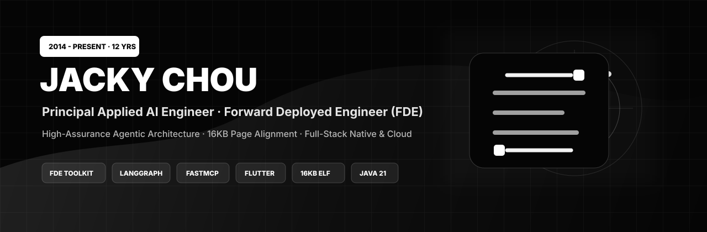

<p align="center">
  <a href="https://mikehot.cloud">
    
  </a>
</p>

# Jacky Chou (周亚杰)

<p align="left">
  <strong>Principal Applied AI Engineer · Forward Deployed Engineer (FDE) · Full-Stack Native & Cloud Architect</strong><br>
  12 年软件系统工程经验（2014 年起至今，经历 Eclipse ADT ➔ Android Studio / Java ➔ Kotlin / Flutter 三端商业端 ➔ Spring Boot 权限中台 ➔ 生产级受控 Agent / FDE 现场交付）。
</p>

<p align="left">
  <em>I engineer mission-critical systems, high-assurance multi-agent architectures, mobile native runtimes, and zero-leak enterprise AI platforms with mathematically verifiable evidence.</em>
</p>

<p align="left">
  <a href="https://github.com/mikehot/fde-tools"></a>
  <a href="https://mikehot.cloud"></a>
  <a href="https://mikehot.cloud/resume/"></a>
  <a href="https://github.com/mikehot/springboot-ai-rag-demo"></a>
  <a href="mailto:mikehot668@gmail.com"></a>
</p>

---

### ⚡ Core Production Stack (核心工业级技术栈)

<p align="left">
  
  
  
  
  
  
  
  
  
  
  
</p>

---

## 🛡️ Four-Dimensional Engineering Moat (四维技术壁垒)

```
                       ┌──────────────────────────────────────────────┐
                       │   High-Assurance Industrial AI & Systems     │
                       └──────────────────────┬───────────────────────┘
                                              │
         ┌────────────────────┬───────────────┴───────────────┬────────────────────┐
         ▼                    ▼                               ▼                    ▼
┌──────────────────┐ ┌──────────────────┐           ┌──────────────────┐ ┌──────────────────┐
│ Systems & Mobile │ │ Enterprise RAG   │           │ Controlled Agent │ │ Field Multimodal │
│ Native Runtimes  │ │ & RBAC Security  │           │ State Machine    │ │ Commercial Loop  │
├──────────────────┤ ├──────────────────┤           ├──────────────────┤ ├──────────────────┤
│ • 16KB Page Align│ │ • Java 21 / SB 3 │           │ • LangGraph DAG  │ │ • Dual-Vision QA │
│ • SafeMethodChan │ │ • Row-Level RBAC │           │ • FastMCP Tools  │ │ • Math Equation  │
│ • Dio 401 Mutex  │ │ • AST Citations  │           │ • 5-Step Breaker │ │ • pHash Idempot. │
└──────────────────┘ └──────────────────┘           └──────────────────┘ └──────────────────┘
```

### 1. 📱 端侧与系统级穿透力 (Systems & Mobile Native Penetration)
> **深度段表解析 · 状态机原子调度 · 并发请求单飞互斥**
* **Google Play 2026 16KB 内存页对齐**：深入 NDK 段表排查，开发纯 Python 64-bit ELF 自动解析器，精准定位非对齐 `.so` 依赖与汇编对齐修复。
* **Flutter-Native 安全通信基座**：设计 `SafeMethodChannel` 原子状态机调度，杜绝跨线程未初始化调用、死锁与内存悬垂指针。
* **网络与并发单飞互斥锁**：Dio 拦截器并发单飞（Single Flight）互斥锁，多请求并发 401 时仅单次换票、无缝重放，杜绝重复请求风暴。

### 2. 🔐 严密权限中台与防幻觉基座 (Strict RBAC & Anti-Hallucination Base)
> **物理行级隔离 · 0% ACL 越权泄露 · 后端真实引用硬校验**
* **Java 21 + Spring Boot 3 + pgvector**：物理隔离与动态 Tenant 过滤，保证多租户 RAG 检索 **0% ACL 越权泄露**。
* **独创后端 AST 引用真实性校验器**：强制模型回答携带物理页码与文本 Chunk Hash，若无真实依据强行断言 `found=false` 并触发人工降级。

### 3. 🤖 受控工业级 Agent 状态机 (Controlled Industrial Agent State Machine)
> **有向无环图 (DAG) · 5 步硬熔断 · 会话级动态撤权**
* **LangGraph + FastMCP 协议标准**：构建有向无环图（DAG），设定 5 步硬熔断（Bounded Loop）阻断模型死循环。
* **复杂意图拆解与动态撤权**：支持多目标递归分解（Decomposition 解决率 100%），高危只读/写入分离，不可逆操作会话级动态撤权与 Human-in-the-Loop 拦截。

### 4. 📄 现场服务多模态商业闭环 (Field Multimodal Commercial Loop)
> **双视觉模型互验 · 金额等式硬断言 · 图像哈希幂等防重**
* **现场单据自动化录入与智能核验**：双视觉模型互验交叉复核、金额等式硬断言（`Subtotal + Tax == Total`）。
* **感知哈希 (pHash) 幂等防重**：计算图片感知哈希与 MD5 组合键，弱网重试时 0 错误率、0 重复单，实现 3.3 个月商业 ROI 回收。

---

## ⭐ Featured Production Toolkits & Repositories (标杆武器库)

| Repository | Focus & Core Moat | Tech Stack | Production Status |
| :--- | :--- | :--- | :---: |
| [**`mikehot/fde-tools`**](https://github.com/mikehot/fde-tools) | **Field Deployed Engineer CLI Toolkit**: 16KB ELF alignment inspector, perceptual dHash idempotency generator, FastMCP server scaffolder, and Golden Dataset Evals runner. | Python 3.9+ · Zero Heavy Deps · CLI | [](https://github.com/mikehot/fde-tools/actions) |
| [**`mikehot/springboot-ai-rag-demo`**](https://github.com/mikehot/springboot-ai-rag-demo) | **Enterprise RAG Knowledge Base Mid-End**: Sanitized Spring Boot 3 + pgvector API demonstrating strict RBAC security, AST citation validation, `found=false` boundaries, unit tests & CI. | Java 21 · Spring Boot 3 · pgvector | [](https://github.com/mikehot/springboot-ai-rag-demo/actions) |
| [**`mikehot/doc-intake-agent`**](https://github.com/mikehot/doc-intake-agent) | **Field Service Document Intake Engine**: Offline-resilient document processing with dual-vision LLM cross-validation, financial math assertions, and Redis-backed idempotency lock. | Python · LangGraph · FastMCP | `Active` |
| [**`mikehot/rag-knowledge-base`**](https://github.com/mikehot/rag-knowledge-base) | **Enterprise RAG Knowledge Base Architecture**: Multi-tenant knowledge base architecture with strict chunk boundaries, evaluation test gate, and out-of-scope human handoff. | Spring Boot · Flutter · pgvector | `Public Demo` |

---

## ⚡ Fast Review Navigation (评审快速通道)

| Target Audience | Recommended Entry | What You Can Verify |
| :--- | :--- | :--- |
| **Hiring & Executive** | [Online Resume (在线中英双语简历)](https://mikehot.cloud/resume/) | 12 年系统演进、实证里程碑、企业级案例深度与技术交付边界 |
| **Enterprise Client** | [Commercial Portfolio (商业交付全景)](https://mikehot.cloud) | 3 天 PoC 交付包、企业私有化部署实施、16KB 排雷方案与阶梯报价 |
| **Engineering Leader** | [FDE CLI Toolkit 源码](https://github.com/mikehot/fde-tools) | 纯 Python ELF 页解析器、pHash 幂等锁、FastMCP 脚手架与 100% CI 绿标 |
| **Security & Architecture** | [Spring Boot RAG 架构演示](https://github.com/mikehot/springboot-ai-rag-demo) | 物理行级 RBAC 过滤、AST 引用校验器、`found=false` 边界与回归测试 |
| **Confidential Verification** | [Email Request (保密审核请求)](mailto:mikehot668@gmail.com) | 私有商业代码库提交记录、生产构建日志、系统架构蓝图与压力测试报表 |

---

## 📜 Core Delivery Principles (四大交付军规)

1. **Evidence First (证据第一)**：架构不是主观空谈；屏幕录屏、构建日志、Lint 检查、CI 绿标、ELF 段表和单测跑分是交付物的天然组成部分。
2. **AI with Ironclad Boundaries (防线严密)**：AI 模型绝不能绕过企业业务权限，绝不能捏造引用。若无真实依据，坚决返回 `found=false` 并平滑降级人工。
3. **Full-Stack Convergence (端云穿透)**：移动端交互体验、底层原生运行时、后端核心状态机与受控智能体，被视为一条完整的工程产品链路。
4. **Instant Value Realization (快速见效)**：每一个企业交付或现场攻坚，均以明确的验收标准、可量化的投入产出比（ROI）为交付红线。

---

## 📬 Contact & Engagements

<p align="left">
  • <strong>Personal Website</strong>: <a href="https://mikehot.cloud">mikehot.cloud</a><br>
  • <strong>Master Resume</strong>: <a href="https://mikehot.cloud/resume/">mikehot.cloud/resume (ZH / EN)</a><br>
  • <strong>Direct Email</strong>: <a href="mailto:mikehot668@gmail.com">mikehot668@gmail.com</a><br>
  • <strong>Location</strong>: Shanghai, China / Remote Global Available
</p>
